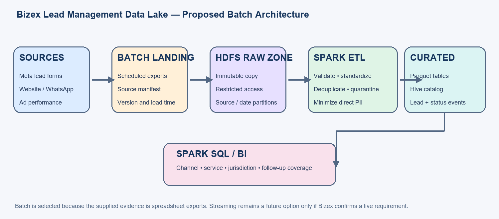

# ISIT312 Big Data Management — Bizex Data Lake Demonstration

**Autumn 2026 | UAE company case study | Synthetic lead data only**

This repository documents a **student proof-of-concept** for a proposed Bizex lead-analytics data lake. It includes the **Scala Spark job that was actually executed on the course VM**, Hive SQL, sample CSV, and screenshots provided by the team. It does **not** contain actual Bizex customer data or evidence of production deployment or company approval.

> **Verified VM path:** synthetic CSV → HDFS raw zone → Spark 3.0.3 / Scala ETL → HDFS Parquet curated zone → Hive 2.1.1 SQL queries. The VM uses Python 3.4.3, so the PySpark alternative was **not executed**. The `spark_etl.scala` script was used via `spark-shell`.

## Observed VM result (12-row synthetic baseline)

| Measurement | Evidence |
|---|---:|
| Raw records processed | 12 |
| Curated unique lead snapshots | 12 |
| Derived status rows | 12 |
| Instagram | 5 |
| Website | 3 |
| Facebook | 2 |
| WhatsApp | 2 |

Screenshot: [actual Scala run](evidence/vm_screenshots/S06_spark_etl_run.png) · [Hive query output](evidence/vm_screenshots/S10_hive_queries_2m16s.png).

**Important:** This 12-row dataset has **no duplicate lead IDs and no missing lead IDs**. The Scala job standardizes values, filters blank IDs, and deduplicates by lead ID, but the run does *not* demonstrate quarantining invalid rows. `Junk / Invalid` is a business status value in one retained record, not a rejected data-quality row. The 16-row fixture and 13 local automated checks are a **different Python reference test** in `local_reference/`.

## Proposed architecture



The architecture image is **the target design**, including capabilities not fully implemented in the VM exercise (for example explicit quarantine and source manifests). The executed Scala job writes `/leads` and `/status_events` Parquet folders. Since its input contains current statuses only, `status_events` should be interpreted as one **derived status row per lead**, *not* an actual history of status transitions.

## Repository files

| Folder / file | What it is | Executed on VM? |
|---|---|---|
| [`spark/spark_etl.scala`](spark/spark_etl.scala) | **Primary working Spark ETL**; source provided by team | **Yes**, via `spark-shell :load` |
| [`hive/create_tables.hql`](hive/create_tables.hql) | Hive database and external Parquet tables | **Yes**, per screenshots |
| [`hive/analysis_queries.sql`](hive/analysis_queries.sql) | Three Hive queries by channel, service/jurisdiction, status | **Yes**, per screenshots |
| [`data/synthetic_leads.csv`](data/synthetic_leads.csv) | Invented 12-row sample, no customer PII | Yes |
| [`evidence/vm_screenshots/`](evidence/vm_screenshots/) | 12 screenshots provided by teammates | Documentation |
| [`docs/VM_DEMO_GUIDE.md`](docs/VM_DEMO_GUIDE.md) | Commands and replay instructions for the course VM | Instructions |
| [`docs/SCREENSHOT_INDEX.md`](docs/SCREENSHOT_INDEX.md) | Captions and screenshot evidence register | Documentation |
| [`docs/data_dictionary.md`](docs/data_dictionary.md) | Synthetic input schema | Documentation |
| [`local_reference/`](local_reference/) | Separate **local Python** 16-row validation fixture, audited ETL, tests and timing experiment | Not run on course VM |
| [`optional_unexecuted/`](optional_unexecuted/) | Original PySpark & Zeppelin alternatives for newer compatible environments | **No**, Python 3.4 incompatible |

## How to reproduce the VM demo

See [VM demo commands](docs/VM_DEMO_GUIDE.md). Your environment must already have running HDFS, Spark, and Hive. Paths may vary with your course VM and user permissions.

The core queries:

```sql
SELECT platform, COUNT(DISTINCT lead_id) AS leads
FROM bizex_lake.curated_leads
GROUP BY platform;
```

## Separate local Python reference validation (optional)

The earlier Python standard-library validation is kept separately to avoid confusing it with the 12-row Spark job. It used a **16-row synthetic quality-testing fixture** and previously passed **13 of 13** automated checks. To rerun in an environment with a compatible `python3`:

```bash
cd local_reference
bash scripts/run_local.sh
```

This pipeline is **not** evidence of distributed processing. Local benchmark numbers compare Python and SQLite under a single-machine workload; they are **not** a controlled Spark-versus-Hive benchmark. The screenshot filenames `S10`/`S11` include command-wall-time labels, but those sessions should not be taken as a fair performance comparison without matching workloads, cache states, and start-up conditions.

## Scope, provenance and limitations

- The 12 synthetic records were created for coursework demonstration and are **not Bizex's internal lead data**.
- The repo provides a functioning **student VM proof of concept**, not a deployed Bizex system.
- The small CSV does not establish Big Data scalability or company data volumes.
- No evidence of an actual Bizex stakeholder interview, sign-off, or performance evaluation is included.
- Real Bizex workbooks, CRM exports, contact details, private lead records, credentials and API keys must **not** be uploaded to public GitHub.
- The original PySpark script cannot run in the provided Python 3.4.3 environment and was not part of the successful demonstration.


